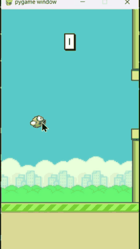

# 🐦 Flappy Bird AI Using Deep Q-Learning (DQN)

An autonomous Flappy Bird agent trained using **Deep Q-Networks (DQN)** with **PyTorch** and **Gymnasium**. The project demonstrates reinforcement learning through experience replay, an ε-greedy exploration strategy, and a target network.

## ✨ Features

- **Deep Q-Network (DQN):** Approximates action-value functions using a neural network built with PyTorch.
- **Experience Replay:** Stores and samples past transitions to improve learning stability.
- **Target Network:** Uses a separate network to calculate target Q-values during training.
- **Configurable Hyperparameters:** Tune the learning rate, discount factor, replay buffer size, batch size, and exploration schedule through YAML.
- **Pre-trained Model:** Includes a saved checkpoint for running the trained agent without training from scratch.
- **Manual Gameplay:** Includes a Pygame-based script for testing the game with keyboard controls.

## 📁 Project Structure

```text
FLAPPYBIRD_RL/
├── runs/
│   └── flappybirdv0.pt       # Saved model checkpoint
├── agent.py                  # Training and evaluation
├── dqn.py                    # PyTorch Q-network
├── experience_replay.py      # Experience replay buffer
├── game_flappy_bird.py       # Manual gameplay
├── parameters.yaml           # Training configuration
├── requirements.txt          # Python dependencies
├── .gitignore                # Git ignore rules
└── README.md                 # Project documentation
```

## 🚀 Getting Started

### 1. Clone the Repository

```bash
git clone https://github.com/Mandeep-Parmar/flappy-bird-dqn.git
cd FLAPPYBIRD_RL
```

### 2. Create a Virtual Environment

**Windows — PowerShell or Command Prompt**

```bash
python -m venv .venv
.venv\Scripts\activate
```

**macOS / Linux**

```bash
python3 -m venv .venv
source .venv/bin/activate
```

### 3. Install Dependencies

```bash
python -m pip install --upgrade pip
pip install -r requirements.txt
```

> **Note:** Use the Python version and package versions compatible with your installed dependencies and saved checkpoint. Test the project in a clean virtual environment before publishing.

## 🎮 Running the Project

### Watch the Pre-trained Agent

Run the agent in evaluation mode:

```bash
python agent.py flappybirdv0
```

This loads the saved checkpoint and runs the agent using the environment and model configuration expected by the code.

### Train the Agent

To start training:

```bash
python agent.py flappybirdv0 --train
```

The training script saves a checkpoint when an episode achieves a new best reward, according to the current implementation.

**Important:** The training command starts a new training run unless checkpoint-resume functionality has been implemented.

### Play Manually

Run the manual gameplay script:

```bash
python game_flappy_bird.py
```

Use the **Space** key to flap, as supported by the game script.

## 📊 Training Results

The following are observed results from recorded runs, not averaged benchmark results.

| Metric | Observed Result |
|---|---:|
| Training episodes reached | 23,350+ |
| Best recorded training reward | 90.5 |
| Recorded evaluation reward | 176.40 (Peak: 243.10) |
| Pipes passed in demo run | 37 (Peak: 51) |

Performance can vary between episodes. In the evaluation demo below, the agent achieves a score of **176.40** and clears **37 consecutive pipes** with stable flight dynamics.

### Evaluation Demo

The trained agent navigating through 37 pipes in evaluation mode (`Reward = 176.40`):

<p align="center">
  
</p>

## ⚙️ Hyperparameters

The training configuration is managed through `parameters.yaml`.

| Parameter | Default | Description |
|---|---:|---|
| `env_id` | `FlappyBird-v0` | Environment identifier |
| `epsilon_init` | `1.0` | Initial exploration rate |
| `epsilon_min` | `0.05` | Minimum exploration rate |
| `epsilon_decay` | `0.995` | Exploration decay factor |
| `replay_memory_size` | `100000` | Maximum replay buffer capacity |
| `mini_batch_size` | `32` | Batch size sampled for training |
| `network_sync_rate` | `10` | Target network synchronization interval, as implemented in the training code |
| `alpha` | `0.001` | Learning rate |
| `gamma` | `0.99` | Discount factor |
| `reward_threshold` | `100` | Episode reward threshold used by the implementation |

The meaning and update frequency of each parameter depend on how it is used in `agent.py`.

## 🧠 Model Architecture

The Q-network is implemented in `dqn.py`.

- **Input layer:** Matches the observation dimension used by the environment configuration.
- **Hidden layer:** Fully connected layer with 256 units and ReLU activation.
- **Output layer:** Produces Q-values for two discrete actions.

| Action | Description |
|---|---|
| `0` | Do nothing |
| `1` | Flap |

Make sure the environment configuration used for evaluation matches the configuration used to train the saved checkpoint. A mismatch in observation dimensions or representation can prevent the model from loading or behaving correctly.

## 📚 How DQN Learns

### 1. ε-Greedy Exploration

The agent explores by taking random actions with probability ε and otherwise chooses the action with the highest predicted Q-value. During training, ε decays toward the configured minimum.

### 2. Experience Replay

The agent stores transitions in a replay buffer and samples mini-batches for training. This reduces the dependence on consecutive experiences.

### 3. Target Network

A separate target network provides the next-state value estimates used in the training target. Its parameters are synchronized with the policy network according to the configured schedule.

### 4. Bellman Target

A standard DQN target can be expressed as:

$$
y = r + \gamma (1 - d) \max_{a'} Q_{\text{target}}(s', a')
$$

Where:

- $r$ is the immediate reward.
- $\gamma$ is the discount factor.
- $d$ indicates whether the transition is terminal.
- $s'$ is the next state.
- $a'$ represents a possible next action.

The network is trained to bring its predicted Q-value for the chosen action closer to the target. The exact loss function and terminal-state handling are determined by the implementation in `agent.py`.

## 🛠️ Technology Stack

- **Python**
- **PyTorch**
- **Gymnasium**
- **flappy-bird-gymnasium**
- **Pygame**
- **NumPy**
- **PyYAML**

## 🙌 Acknowledgments

- [flappy-bird-gymnasium](https://github.com/Talendar/flappy-bird-gymnasium) — Flappy Bird environment.
- [Gymnasium](https://gymnasium.farama.org/) — Reinforcement learning environment API.
- [PyTorch](https://pytorch.org/) — Deep learning framework.
